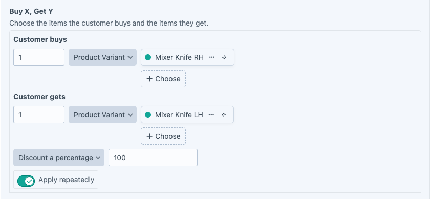
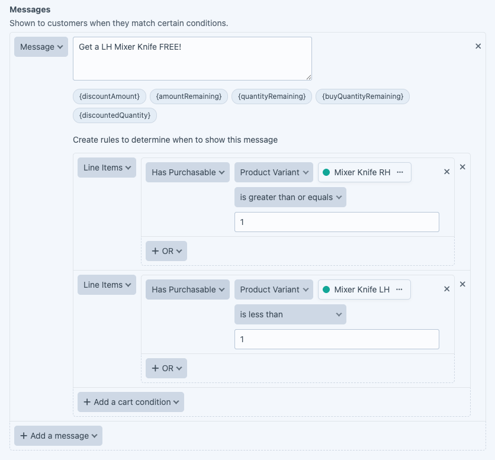

# Recipe: buy one, get one free

Goal: a free pair of Classic Socks with every Classic Tee.

1. Go to **Advanced Discounts -> Discounts** and click **New discount**. Name it "Free socks with a tee", and set **Type** to **Buy X, Get Y**.
2. Leave **Stop Processing Further Discounts** off, so customers can still earn other discounts.
3. Give the group a **Discount Name**.
4. Under **Customer buys**, set the quantity to 1 and choose Classic Tee.
5. Under **Customer gets**, set the quantity to 1 and choose Classic Socks.
6. Choose **Discount a percentage** and enter 100, which makes the socks free.
7. Leave **Apply repeatedly** on, so the reward is earned once per tee.

   

8. Add any messages you want the customer to see when they qualify.

   

9. Click **Save discount**.

With 4 tees and 4 pairs of socks in the cart, all 4 pairs are free. The plugin does not add the socks to the cart.

## Where to go next

- [Cart actions](../user-guide/cart-actions.md#buy-x-get-y), how the reward quantity is worked out when the trigger and reward are the same product.
- [Messages](../user-guide/messages.md), the tokens available to a Buy X, Get Y discount.
