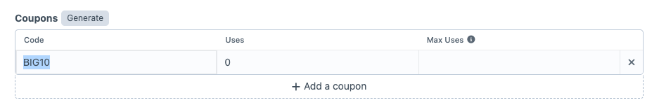
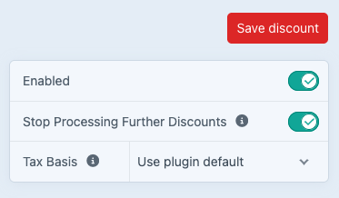
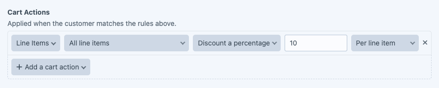
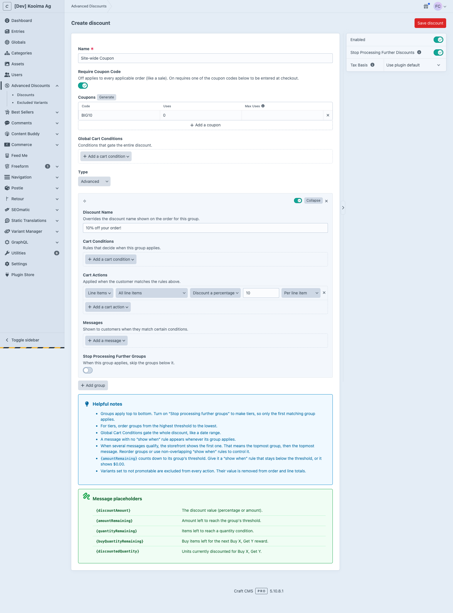
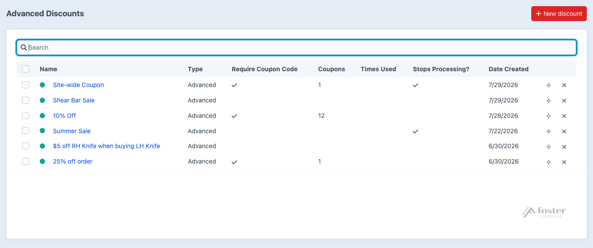

# Recipe: coupon for 10% off all products

Goal: a coupon code that takes 10% off every product in the cart, and stops the Advanced Discounts discounts below it from applying.

1. Go to **Advanced Discounts -> Discounts** and click **New discount**. Name it "Site-wide coupon".
2. Turn on **Require Coupon Code**, so the discount applies only when the customer enters a code.
3. Click **Add a coupon** and enter `BIG10` as the **Code**. Leave **Max Uses** blank for unlimited.

   

4. Turn on **Stop Processing Further Discounts**. When this coupon applies, the plugin skips the discounts below it. Commerce's own discounts still apply.

   

5. Leave **Global Cart Conditions** empty, since the code is the only restriction.
6. Leave **Type** on **Advanced**.
7. Give the group a **Discount Name**. The customer sees this name in the checkout once the coupon applies.
8. Skip **Cart Conditions**. Under **Cart Actions**, add a **Line Items** action. Leave **Apply to** on **All line items**, choose **Discount a percentage**, enter 10, and leave **Apply per** on **Per line item**.

   

9. Skip **Messages**. The customer already sees the coupon applied in the cart.

   

10. Click **Save discount**. The plugin saves a new discount at the top of the index and evaluates that discount first.

    

Entering `BIG10` at checkout now takes 10% off every promotable line in the order.

## Where to go next

- [Coupon codes](../user-guide/coupons.md), generating codes in bulk and setting usage limits.
- [Cart actions](../user-guide/cart-actions.md), the other actions a group can run.
