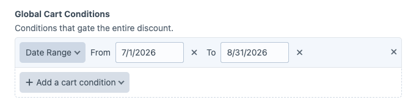
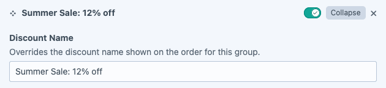
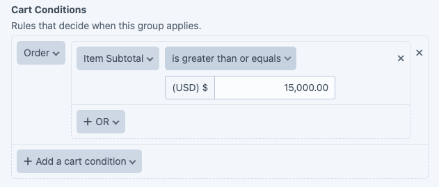
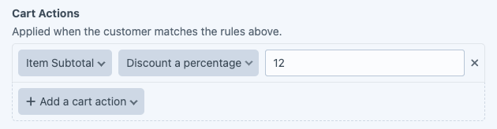
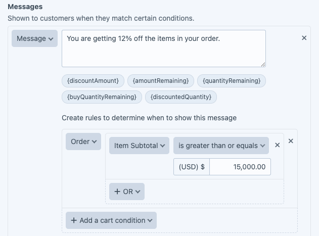
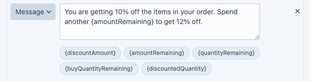
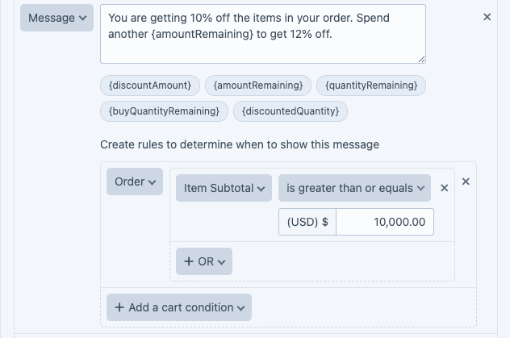
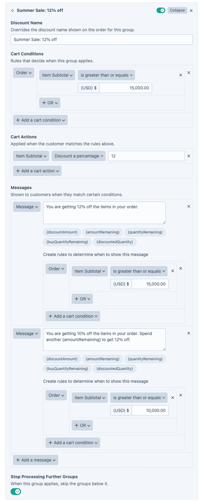
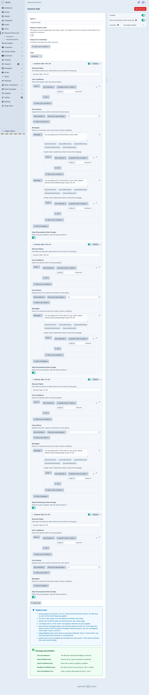

# Recipe: tiered sale

Goal: a sale running through July and August, where the discount grows with the cart value.

- Spend \$2,500, get 5% off
- Spend \$7,000, get 7% off
- Spend \$10,000, get 10% off
- Spend \$15,000, get 12% off

Each tier is one group inside a single discount, with its own conditions, actions, and messages. The plugin evaluates groups top to bottom, and each tier stops the ones below it, so build the highest tier first.

1. Go to **Advanced Discounts -> Discounts** and click **New discount**. Name it "Summer Sale".
2. Under **Global Cart Conditions**, add a **Date Range** covering July and August.

   

3. Leave **Type** on **Advanced**.
4. Start with the 12% tier. Give the group a **Discount Name** that names the tier.

   

5. Under **Cart Conditions**, add an **Order** condition with an **Item Subtotal** rule set to **is greater than or equals** \$15,000.

   

6. Under **Cart Actions**, add an action giving 12% off.

   

7. Add a message telling the customer they have qualified for 12% off.

   

8. Add a second message showing how far the customer is from the tier, such as "Spend another {amountRemaining} to get {discountAmount} off". For the full token list, see [messages](../user-guide/messages.md#tokens).

   

9. Give the second message two show-when rules, each its own **Order** condition: **Item Subtotal** **is greater than or equals** \$10,000, and **Item Subtotal** **is less than** \$15,000. Separate conditions must all match, so the message shows only between the two amounts.

   

10. Turn on **Stop Processing Further Groups**, so a cart at this tier does not also get the lower tiers.

    

11. Click **Add group** for each remaining tier, in descending order. Give each lower tier's qualifying message show-when rules with an upper limit, such as **Item Subtotal** **is less than** \$15,000 on the 10% tier. **Stop Processing Further Groups** does not hide messages.
12. Click **Save discount**.

## Where to go next

- [Messages](../user-guide/messages.md), the full token list and how show-when rules work.
- [Displaying promotional messages](../dev-guide/displaying-messages.md), rendering the messages on the storefront.
