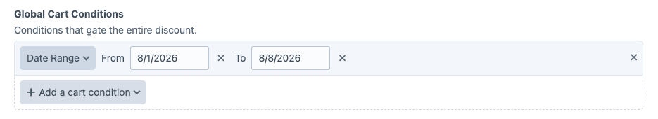
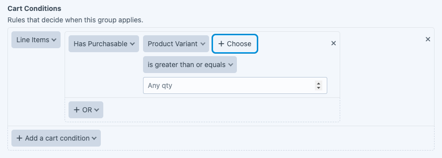
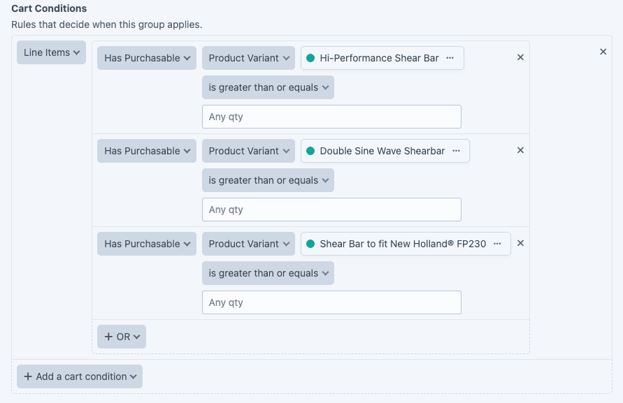
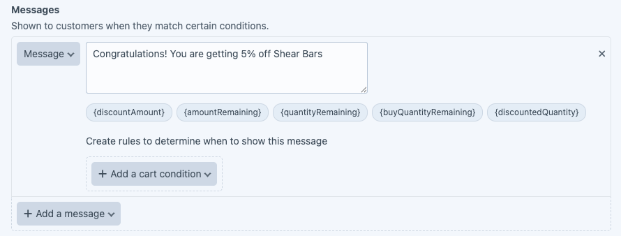

# Recipe: discounting a few products for a week

Goal: 5% off a chosen set of products for one week, without a coupon code.

1. Go to **Advanced Discounts -> Discounts** and click **New discount**. Name it "Tee Week".
2. Under **Global Cart Conditions**, add a **Date Range** covering the week. **To** is inclusive, so August 1 to August 7 runs the full seven days.

   

3. Give the group a **Discount Name**, "5% off tees".
4. Under **Cart Conditions**, add **Line Items**, then add a **Quantity** rule.

   

5. Click **Choose** and pick a product. To apply the discount only once the customer has 2 or more of the item, set the quantity to 2.
6. For each other product you want to include, click **+ OR** and pick it.

   

7. Under **Cart Actions**, add **Line Items**. Set **Apply to** to **Same line items as cart conditions**, choose **Discount a percentage**, and enter 5. The action discounts the products the conditions matched, so you name the products once.
8. Add a message so the customer sees the discount in the cart.

   

9. Click **Save discount**.

## Where to go next

- [Cart conditions](../user-guide/cart-conditions.md), the full set of condition rules.
- [Excluded variants](../user-guide/excluded-variants.md), why a selected product might not be discounted.
