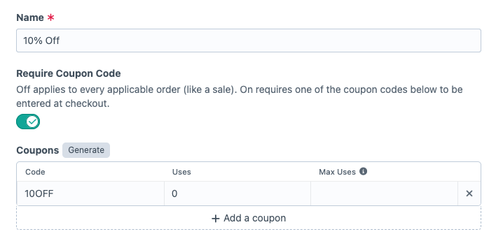
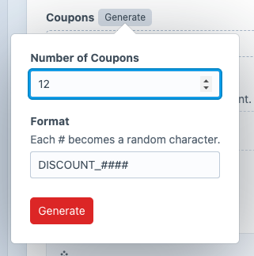
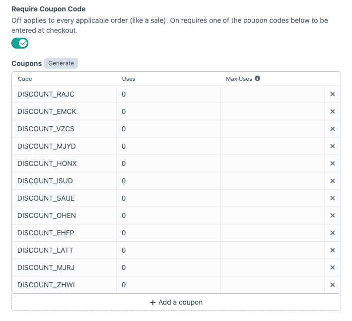

# Coupon codes

**Require Coupon Code** sets how a discount is triggered. Off, it applies to every order matching its rules, like a sale. On, the customer has to enter one of its codes at checkout.

## Adding codes

Add codes by hand with **Add a coupon**, or click **Generate** for a batch.

Enter the **Number of Coupons** and a **Format**. Each `#` becomes a random character, so `SPRING_####` produces codes like `SPRING_A7K2`. The default format is `DISCOUNT_####`.

Codes are unique across every discount, not only this one, and a code can't appear twice on one discount. Generated codes avoid codes already in use, and saving a duplicate by hand fails validation. Matching at checkout ignores case, so `BIG10` and `big10` are the same code.

## Uses and limits

**Uses** counts completed orders the discount applied to. The count goes up when the order completes, so a code in an abandoned cart does not count against its limit.

Leave **Max Uses** blank for unlimited. Once a code's uses equal **Max Uses**, the code stops working.

## What the customer sees

If a code is at its limit or belongs to a disabled discount, the plugin removes it from the cart and adds a notice. The notice reads "This coupon has reached its usage limit." or "This coupon is no longer available." To show customers why a code was removed, render `order.notices` in your cart template.

An order holds one coupon code at a time. Entering a second code replaces the first.

Advanced Discounts codes and Commerce's own coupon codes are separate sets. The plugin leaves a code it does not recognize to Commerce. If the same code exists in both, both discounts apply to the order.

Deleting a discount deletes its codes.
