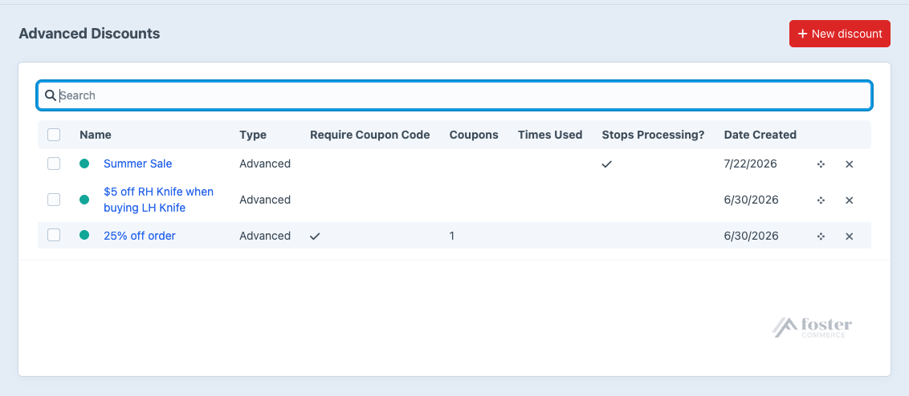
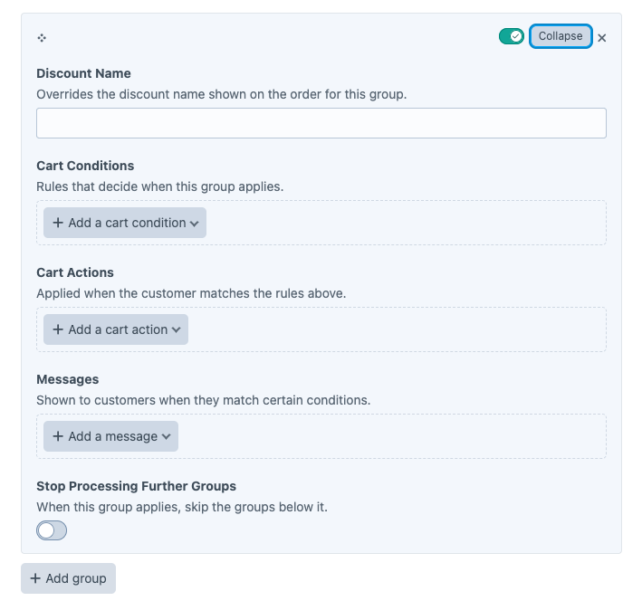
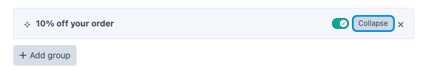

# Discounts

How to create, order, and structure discounts. **Advanced Discounts -> Discounts** lists every discount in the order the plugin evaluates them, with a search field.

A discount holds one optional set of Global Cart Conditions and any number of groups. Each group pairs its own cart rules with the actions and messages they trigger. One discount can hold a whole tiered sale: 10% off at \$100, 15% at \$200, 20% at \$500.

## Creating a discount

Click **New discount**.

The plugin saves a new discount at the top of the list, where it is evaluated first. Discounts are evaluated top down. To change the order, drag discounts on the index.

### Name

Names the adjustment on the order, unless the group sets its own **Discount Name**.

### Require Coupon Code

Turn on **Require Coupon Code** to gate the discount behind a code. See [coupon codes](coupons.md).

### Type

**Advanced** covers standard sales and promotions.

**Buy X, Get Y** covers "buy one, get one free" style offers. Choose the products the customer buys and the products they get. The plugin counts the chosen buy products together.

Changing **Type** replaces the groups with a new, empty set for that type. Switching back before you save restores the earlier groups. When you click **Save discount**, the plugin keeps only the groups of the selected type.

### Tax Basis

Sets whether tax is calculated before or after the discount comes off. Default: **Use plugin default**. See the [configuration reference](../reference/configuration.md#tax-basis).

### Stop Processing Further Discounts

When this discount applies, the plugin skips the Advanced Discounts discounts below it. Commerce's own discounts still apply.

## Conditions

Conditions decide when a discount applies to the cart. There are two kinds: Global Cart Conditions, and the [Cart Conditions](cart-conditions.md) inside each group.

### Global Cart Conditions

Global Cart Conditions gate the whole discount, whatever its groups say. For example, a date range covering the first week of August. They are optional, and you can add more than one. They offer the same rules as a group's Cart Conditions.

### Cart Conditions

The plugin tests a group's Cart Conditions only after the discount's Global Cart Conditions match. For the rules on offer and how they combine, see [cart conditions](cart-conditions.md).

## Discount groups

To add a group, click **Add group**.

**Discount Name** on the group replaces the discount's own name on the order when this group applies.

[Cart Conditions](cart-conditions.md) set the rules.

[Cart Actions](cart-actions.md) set what the group discounts when those rules match.

[Messages](messages.md) tell the customer they are close to, or have reached, the threshold.

**Stop Processing Further Groups** skips every group below this one once this group applies.

### Group controls

Each group's actions menu holds these controls. You can also drag a group to a new position.

- **Collapse** and **Open** hide and show the group's body. Double-clicking the group's bar does the same.
- **Disable** takes the group out of the discount: it does not discount the order or show messages, whatever its conditions say. Disabling collapses the group and marks it with a gray dot. **Enable** turns the group back on.
- **Move up** and **Move down** reorder groups. Order decides which group wins when **Stop Processing Further Groups** is on.
- **Delete** removes the group from the screen. The group is removed from the discount when you click **Save discount**.

