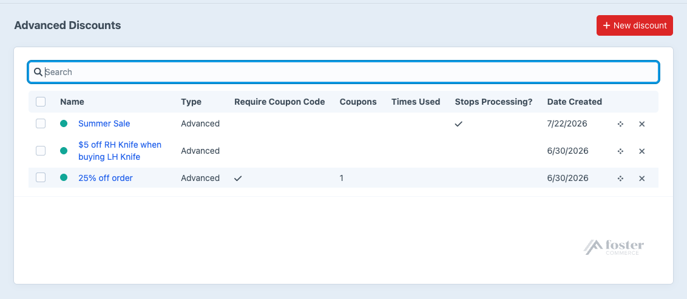
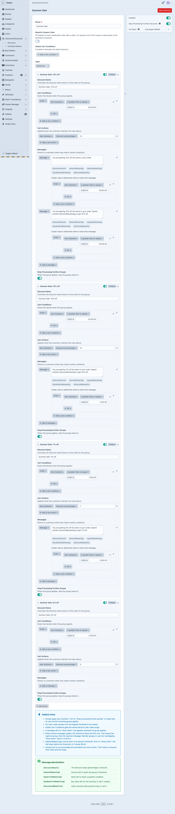
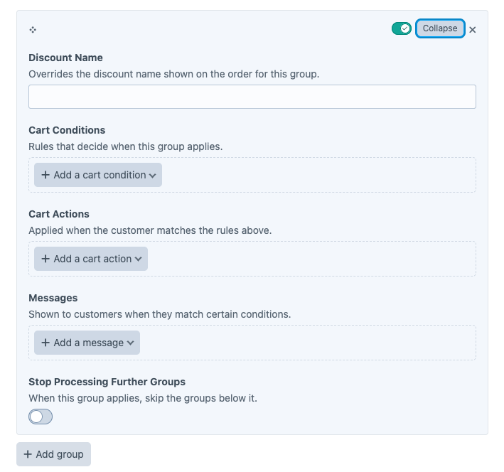
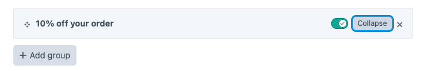

# Discounts

How to create, order, and structure discounts. **Advanced Discounts -> Discounts** lists every discount in the order the plugin evaluates them, with a search field.

A discount holds optional Global Cart Conditions, optional Global Product Conditions, and any number of groups. Each group pairs its own cart rules with the actions and messages they trigger. One discount can hold a whole tiered sale: 10% off at \$100, 15% at \$200, 20% at \$500.

## Creating a discount

Click **New discount**.

The plugin saves a new discount at the top of the list, where it is evaluated first. Discounts are evaluated top down. To change the order, drag discounts on the index.

### Name

Names the discount in the control panel. Customers see each group's **Discount Name** instead.

### Require Coupon Code

Turn on **Require Coupon Code** to gate the discount behind a code. See [coupon codes](coupons.md).

### Type

**Advanced** covers standard sales and promotions.

**Buy X, Get Y** covers "buy one, get one free" style offers. Choose the products the customer buys and the products they get. The plugin counts the chosen buy products together.

Changing **Type** replaces the groups with a new, empty set for that type. Switching back before you save restores the earlier groups. When you click **Save discount**, the plugin keeps only the groups of the selected type. Saving a type other than **Advanced** clears Global Product Conditions.

### Tax Basis

Sets whether tax is calculated before or after the discount comes off. Default: **Use plugin default**. See the [configuration reference](../reference/configuration.md#tax-basis).

### Stop Processing Further Discounts

When this discount applies, the plugin skips the Advanced Discounts discounts below it. Commerce's own discounts still apply.

## Conditions

Global Cart Conditions and each group's [Cart Conditions](cart-conditions.md) decide when a discount applies. Global Product Conditions decide which line items the discount covers.

### Global Cart Conditions

Global Cart Conditions gate the whole discount, whatever its groups say. For example, a date range covering the first week of August. They are optional, and you can add more than one. They offer the same rules as a group's Cart Conditions.

### Global Product Conditions

Global Product Conditions limit an **Advanced** discount to line items for matching products or variants. The field appears only when **Type** is **Advanced**, because Buy X, Get Y names its own products. Click **Limit to**, choose **Products** or **Variants**, then add rules for that type. The rules include Commerce's own, one for each field, and **Product** or **Variant** to choose items directly. For example, choose **Products** and add a rule for the field that marks parts.

To add another row, click **OR**. A line item matches when any row matches it. Each row needs at least one rule.

Only matching line items count toward the discount's conditions and the amounts in its messages. Only matching line items get the discount. A **Shipping** action takes its discount off the whole shipping cost, and only when the cart has at least one matching line item. Line items that do not match can still get later discounts, unless this discount has **Stop Processing Further Discounts** on.

To cover every product, leave Global Product Conditions empty.

### Cart Conditions

The plugin tests a group's Cart Conditions only after the discount's Global Cart Conditions match. For the rules on offer and how they combine, see [cart conditions](cart-conditions.md).

## Discount groups

To add a group, click **Add group**.

**Discount Name** names the adjustment on the order when this group applies. Every group needs one, so the discount's own name stays internal.

[Cart Conditions](cart-conditions.md) set the rules.

[Cart Actions](cart-actions.md) set what the group discounts when those rules match.

[Messages](messages.md) tell the customer they are close to, or have reached, the threshold.

**Stop Processing Further Groups** skips every group below this one once this group applies.

### Group controls

Each group's actions menu holds these controls. You can also drag a group to a new position.

- **Collapse** and **Open** hide and show the group's body. Double-clicking the group's bar does the same.
- **Disable** takes the group out of the discount: it does not discount the order or show messages, whatever its conditions say. Disabling collapses the group and marks it with a gray dot. **Enable** turns the group back on.
- **Move up** and **Move down** reorder groups. Order decides which group wins when **Stop Processing Further Groups** is on.
- **Delete** removes the group from the screen. The group is removed from the discount when you click **Save discount**.

## Text for each site

On a multi-site install, three fields can be set for each site: the discount's **Name**, each group's **Discount Name**, and each [message](messages.md). These fields show Craft's translation icon. Every other setting, including groups, conditions, actions, and coupons, is shared by all sites. A group added or deleted while editing one site is added to or deleted from every site.

To edit a site's text, choose the site from the site menu at the top left of **Advanced Discounts -> Discounts** or of a discount. The site stays selected as you move between the index and a discount, and the index lists each discount's name for that site.

**New discount** opens on the primary site, because the primary site's **Name** is required.

### Blank text uses the primary site's text

When a site's field is blank, that site uses the primary site's text, which the field shows as its placeholder. A blank field keeps following the primary text: after you edit the primary **Message**, every site without its own message shows the new wording.

Text you enter for a site does not change when the primary text changes. When you change the primary wording, update each site's text as well.

The order's site sets which text the customer sees. For the name on the order's adjustment, the plugin uses the first of these that is set:

1. The group's **Discount Name** for the order's site.
2. The group's **Discount Name** on the primary site.

A group saved before **Discount Name** was required can still be blank. It shows the discount's **Name** until you give it one.

A completed order keeps the adjustment name it was placed with.
